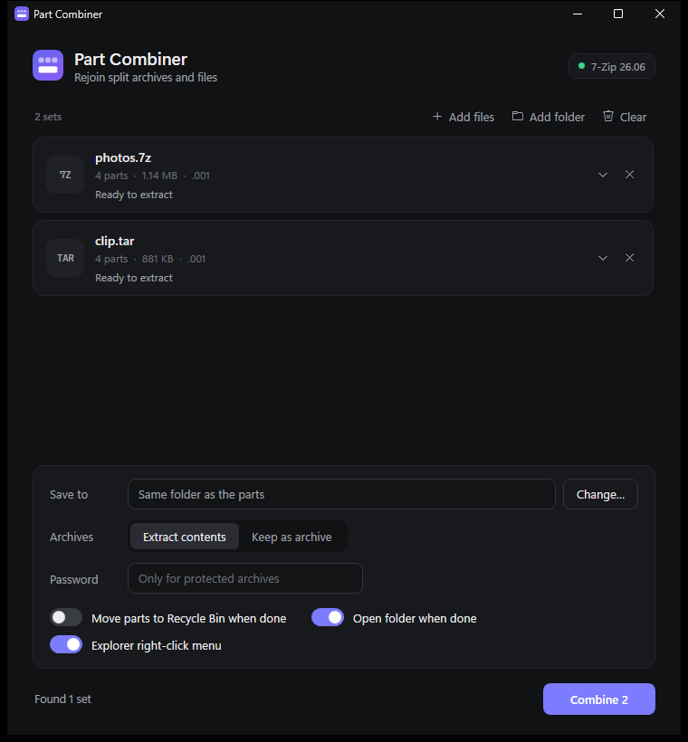

# Part Combiner

A small, minimal Windows app that puts split archives and files back together.
Drop in any one part (or a folder) and it finds the rest, checks that every part is present and
belongs to the same set, then extracts or re-joins them. The dark or light theme follows your Windows setting.

<p align="center"></p>

## Download

From the [latest release](../../releases/latest), for 64-bit Windows 10 and 11:

- **`PartCombinerSetup.exe`**: installs Part Combiner for your account (no admin rights needed) with a Start menu
  shortcut, an optional desktop shortcut and Explorer menu entry, and an entry in *Settings › Apps* to uninstall it.
- **`PartCombiner.exe`**: the portable version. Run it from anywhere; nothing is installed.

Install [7-Zip](https://www.7-zip.org/) too if you want to extract RAR, 7z or ZIP archives.

### Updates

When a newer release is published here, an **Update** badge appears at the top of the window. Click it to download
the new version and restart into it. The download is used only if its SHA-256 matches the checksum GitHub publishes
for the file. The check sends nothing about you or your files, and you can turn it off with **Check for updates**.
If the app's folder can't be written to, the badge opens the release page instead.

## Using it

1. Run `PartCombiner.exe` (or build it, see below).
2. Drag any part, several parts or a whole folder onto the window, or use **Browse files** / **Browse folder**.
   You can also drop parts onto the exe itself, use *Open with*, or turn on the **Explorer right-click menu**.
   If Part Combiner is already open, those go to the open window instead of starting a second copy.
3. Press **Combine**.

For `Movie.part1.rar`, `Movie.part2.rar`, `Movie.part3.rar`, dropping any one of them is enough. The archive is
extracted with 7-Zip into the folder next to the parts:

- if the archive holds one folder (the usual case), you get that folder;
- if it holds several loose items, they go into a new folder named after the archive;
- existing files and folders are never overwritten. A new name like `Movie (2)` is used instead.

### Options

| Option | What it does |
| --- | --- |
| **Save to** | Next to the parts (default) or any folder you pick. |
| **Archives** | For byte-split archives (`.7z.001`, `.zip.001`, `.zip.part1` …): *Extract contents*, or *Keep as archive* to just rebuild `name.7z`. RAR and `.z01` volumes are always extracted. |
| **Password** | For protected archives. It's passed to 7-Zip via stdin, never on the command line. |
| **Move parts to Recycle Bin** | After a successful combine only. Windows asks before deleting anything too big for the Recycle Bin. |
| **Open folder when done** | Shows the result in Explorer. |
| **Check for updates** | Looks for a newer release on GitHub when the app starts (on by default). |
| **Explorer right-click menu** | Adds *Combine with Part Combiner* to the right-click menu of part files (`.001`, `.part1`, `.r00`, `.z01`, `.rar` …) and folders. On Windows 11 it's under *Show more options*. Written for your account only (no admin); turning it off removes it again. If you move the exe, the entry follows it the next time you start the app. |

## Supported part names

| Naming | Example | Result |
| --- | --- | --- |
| RAR volumes | `name.part1.rar`, `name.part01.rar` … (first part may be `.part1.exe`) | extracted |
| Old-style RAR | `name.rar`, `name.r00` … `name.r99`, `name.s00` … | extracted |
| Spanned ZIP | `name.z01`, `name.z02` … `name.zip` | extracted |
| Numbered | `name.7z.001`, `name.zip.001`, `name.rar.001`, `name.001` | extracted or joined |
| `.part` suffix | `name.zip.part1`, `movie.mkv.part01` | extracted or joined |
| Unix `split` | `name.aa`, `name.ab` … (also `.aaa` …) | joined |
| Tarballs | `name.tar.gz.001`, `.tgz`, `.tar.bz2`, `.tar.xz`, `.tar.zst` | fully unpacked |
| Any other file | `movie.mkv.001`, `disk.iso.part1` … | joined byte for byte |

There's no limit on how many parts a set can have. Part numbers can go up to 9 digits, and sets with thousands of
volumes are tested.

Total Commander style `.crc` files are picked up automatically. They supply the original file name, and the joined
file is checked against the stored size and CRC32.

## Mismatched or missing parts are never combined

Before anything is written, every set is checked. If any check fails, the set is marked **Won't be combined**,
its card opens to list the exact problem, and **Combine** skips it:

- a missing part anywhere in the sequence, including the first or the final `.zip`;
- parts that are a different size from the rest (an incomplete download or a part from another set);
- two files claiming the same position (`x.part1.rar` and `x.part01.rar`), or mixed numbering styles;
- RAR volumes whose own headers disagree with their position: a volume number that doesn't match, a first volume
  in the middle, a standalone archive among volumes, mixed RAR4/RAR5, or a file that isn't RAR at all;
- a RAR set whose last volume says more volumes follow;
- a 7z archive whose header says it's longer or shorter than the parts add up to;
- a spanned ZIP whose `.zip` records a different number of parts;
- a first part that doesn't start like the archive type its name claims;
- a `.crc` size or checksum that doesn't match;
- a part that changed on disk after it was added.

Before extracting, 7-Zip is asked how big the contents are once unpacked. If that won't fit on the destination
drive, the set fails right away with the space needed, instead of 7-Zip running out of room halfway through. (Archives
with encrypted file names can't be measured without the password; for those the check is skipped.)

Extraction always happens in a hidden temporary folder (`.pc-…`) next to the output. If 7-Zip reports any error
or warning (a wrong password, a damaged or swapped part, a CRC error inside the archive), that folder is deleted
and nothing is saved.

## Requirements

- Windows 10 or 11 (64-bit).
- [7-Zip](https://www.7-zip.org/) for extracting RAR, 7z and ZIP archives. It's found automatically (standard
  install, registry, PATH, or a `7z.exe` next to the app). You can also click the 7-Zip badge to pick `7z.exe`.
  Re-joining plain split files works without it.

## Building

Needs the .NET 10 SDK.

```powershell
.\build.ps1                      # runs the tests, then builds publish\PartCombiner.exe (standalone, ~60 MB)
                                 # and publish\PartCombinerSetup.exe (the same program; that name opens the installer)
.\build.ps1 -FrameworkDependent  # small exe that needs the .NET 10 Desktop Runtime
dotnet test                      # tests only
```

Project layout:

- `src/PartCombiner.Core`: part detection, consistency checks, byte joiner, 7-Zip runner, update checker, installer
- `src/PartCombiner.App`: the WPF interface (dark/light theme follows Windows)
- `tests/PartCombiner.Tests`: unit tests plus end-to-end tests against the installed 7-Zip
- `tools/make-icon.ps1`: regenerates the app icon

Settings, including the window's position, size and maximized state, are stored in
`%APPDATA%\PartCombiner\settings.json`. Set `PARTCOMBINER_MULTI=1` to allow more than one window (for testing).

## License

Copyright © 2026 Pixelplayz2215. All rights reserved.

The source is published for viewing only. No license is granted to copy, modify or redistribute it. You're welcome
to download and use the released `PartCombiner.exe`.
